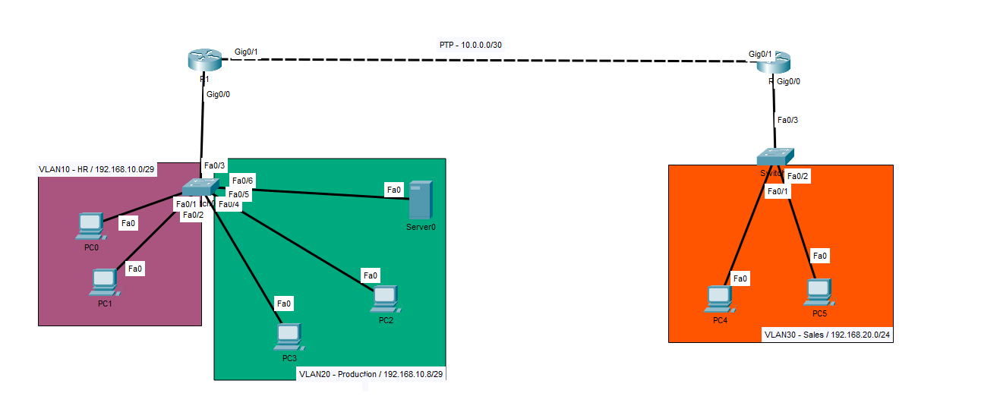

# Static Routing, VLANs & Inter-VLAN Routing Lab



A networking lab covering:
- Static routing
- Multiple VLANs
- Inter-VLAN routing using ROAS (Router-on-a-Stick)

## VLAN Configuration

### LAN1

| VLAN ID | Name | Purpose |
|:---:|---|---|
| 10 | HR | Human Resources |
| 20 | Production | Production |
| 999 | UNUSED | Native VLAN |

### LAN2

| VLAN ID | Name | Purpose |
|:---:|---|---|
| 30 | Sales | Sales |
| 999 | UNUSED | Native VLAN |

## IP Addressing

### LAN1

**VLAN 10 – HR**

| Network Information | IP Address |
|---|---|
| Network address | `192.168.10.0/29` |
| First usable address | `192.168.10.1` |
| Last usable address | `192.168.10.6` |
| Broadcast address | `192.168.10.7` |
| Next subnet | `192.168.10.8/29` |

**VLAN 20 – Production**

| Network Information | IP Address |
|---|---|
| Network address | `192.168.10.8/29` |
| First usable address | `192.168.10.9` |
| Last usable address | `192.168.10.14` |
| Broadcast address | `192.168.10.15` |
| Next subnet | `192.168.10.16/29` |

### LAN2

**VLAN 30 – Sales**

| Network Information | IP Address |
|---|---|
| Network address | `192.168.20.0/24` |
| First usable address | `192.168.20.1` |
| Last usable address | `192.168.20.254` |
| Broadcast address | `192.168.20.255` |
| Next subnet | `192.168.21.0/24` |

## Point-to-Point (PTP) Link

| Device | Interface | IP Address |
|---|---|---|
| R1 | G0/1 | `10.0.0.1/30` |
| R2 | G0/1 | `10.0.0.2/30` |

## Routing Tables

### R1 – Static Routes

```text
10.0.0.0/8 is variably subnetted, 2 subnets, 2 masks
C    10.0.0.0/30 is directly connected, GigabitEthernet0/1
L    10.0.0.1/32 is directly connected, GigabitEthernet0/1

192.168.10.0/24 is variably subnetted, 4 subnets, 2 masks
C    192.168.10.0/29 is directly connected, GigabitEthernet0/0.10
L    192.168.10.6/32 is directly connected, GigabitEthernet0/0.10
C    192.168.10.8/29 is directly connected, GigabitEthernet0/0.20
L    192.168.10.14/32 is directly connected, GigabitEthernet0/0.20

S    192.168.20.0/24 [1/0] via 10.0.0.2
```

### R2 – Static Routes

```text
10.0.0.0/8 is variably subnetted, 2 subnets, 2 masks
C    10.0.0.0/30 is directly connected, GigabitEthernet0/1
L    10.0.0.2/32 is directly connected, GigabitEthernet0/1

S    192.168.10.0/24 [1/0] via 10.0.0.1

192.168.20.0/24 is variably subnetted, 2 subnets, 2 masks
C    192.168.20.0/24 is directly connected, GigabitEthernet0/0
L    192.168.20.254/32 is directly connected, GigabitEthernet0/0
```

## Notes

- R1 provides inter-VLAN routing for VLANs 10 and 20 using ROAS.
- R2 connects LAN2 (VLAN 30).
- R1 and R2 communicate over a point-to-point link.
- Static routes enable communication between LAN1 and LAN2.
- VLAN 999 is configured as the native VLAN.